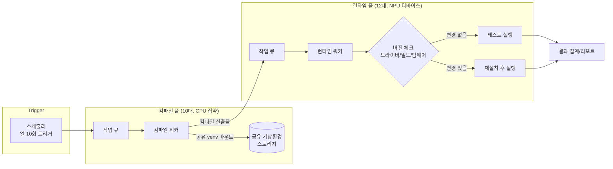
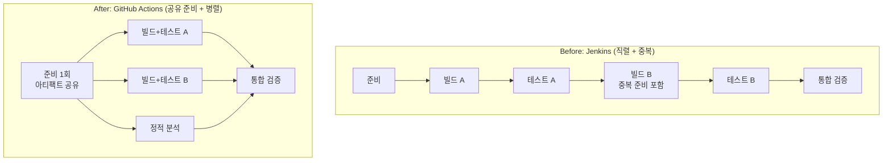
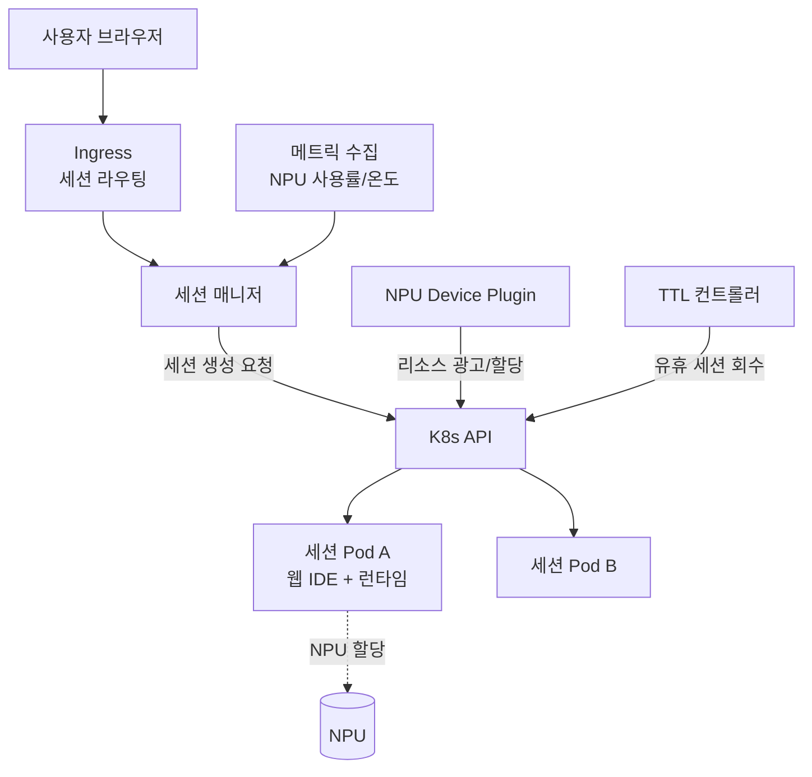

# 기술 포트폴리오 — 강상민

> 인프라 자동화 관점에서 진행한 프로젝트 3개의 설계 과정을 정리했습니다.
> 전/현직 회사의 영업비밀 보호를 위해 내부 코드·도구명·수치 일부는 일반화했으며, 다이어그램은 모두 직접 다시 그린 것입니다.

📧 sangmin082@gmail.com · [github.com/sangmin082](https://github.com/sangmin082) · [linkedin.com/in/sangmin082](https://linkedin.com/in/sangmin082)

---

## 1. 회귀 테스트 자동화 플랫폼 — 서버 22대로 600개 모델 × 일 10회 돌리기

### 배경과 제약

NPU 컴파일러/런타임이 매일 여러 번 갱신되는 환경에서, 약 **600개 모델 변형**에 대해 "컴파일 → 디바이스 런타임 검증(bitmatch)" 워크플로우를 **하루 10회** 실행해야 했습니다. 가용 자원은 컴파일 서버 10대, NPU가 장착된 런타임 서버 12대가 전부였습니다.

단순 계산으로도 사이클당 처리량이 빠듯했는데, 실제 병목은 계산이 아니라 **반복 셋업(Toil)**이었습니다. 실행마다 파이썬 환경 구성, 드라이버·펌웨어·빌드 설치가 반복되면서 순수 테스트 시간보다 준비 시간이 커지는 구조였습니다.

### 아키텍처

### 핵심 설계 결정

**결정 1 — 컴파일 환경은 "매번 만들지 말고 공유한다"**
컴파일 단계의 셋업 대부분이 동일한 파이썬 의존성 구성이었습니다. 서버별로 매 실행 생성하던 venv를 공유 스토리지의 단일 venv로 통합하고 워커가 마운트해서 쓰도록 변경했습니다.
- 트레이드오프: 의존성 변경 시 전체 워커에 동시 영향 → venv 갱신을 별도 단계로 분리하고 갱신 중에는 큐를 잠그는 것으로 해결
- 효과: 사이클마다 반복되던 환경 구성 시간이 0에 수렴

**결정 2 — 런타임 셋업은 "무조건 하지 말고 조건부로 한다"**
드라이버·빌드·펌웨어 설치는 실제로 버전이 바뀌었을 때만 의미가 있습니다. 실행 전 각 구성요소의 버전을 체크해 **변경분만 재설치**하는 로직을 넣었습니다. "매번 전체 셋업"이라는 안전하지만 낭비인 관행을, 시스템이 판단하는 조건부 셋업으로 바꾼 것입니다.
- 실패 대비: 버전 체크를 통과했는데 환경이 깨진 경우를 위해 실패 시 1회 풀 셋업 후 재시도하는 폴백 경로를 유지

**결정 3 — 자원 특성이 다른 두 단계를 분리 스케줄링**
컴파일(CPU 집약)과 런타임(디바이스 종속)은 병목 자원이 다르므로 풀을 분리하고 큐를 독립 운영해, 한쪽 단계의 지연이 다른 쪽 자원을 놀리지 않도록 했습니다.

### 결과

- 제한된 자원으로 일 10회 전체 회귀 사이클을 **수작업 개입 없이** 안정 운영
- 셋업 오버헤드 제거로 사이클당 실행 시간 단축 <!-- TODO: 실제 단축 수치가 있으면 기입 (예: 사이클당 N분 → M분) -->
- 회귀 실패가 "발견되는 것"이 아니라 "자동으로 보고되는 것"이 되면서, 컴파일러/런타임 팀의 릴리스 판단 기준으로 정착

---

## 2. CI 파이프라인 재설계 — Jenkins → GitHub Actions, 실행 시간 40% 단축

### 문제

레거시 Jenkins 기반 PR 검증 파이프라인은 오래 걸리고, 스테이지가 복잡하게 얽혀 있어 수정이 두려운 상태였습니다. "CI가 느리다"는 불만은 많았지만 **어디가 왜 느린지**는 아무도 정량적으로 알지 못했습니다.

### 접근: 고치기 전에 측정

각 스테이지의 실행 시간을 수집해 병목을 분석했고, 두 가지 패턴을 찾았습니다:

1. **중복 실행** — 서로 다른 스테이지가 동일한 빌드/준비 작업을 각자 수행
2. **불필요한 직렬화** — 의존성이 없는 빌드·테스트 잡들이 순차로 묶여 있음

### Before / After

### 설계 원칙

- 준비 단계는 한 번만 실행하고 산출물을 아티팩트로 공유
- 의존성 없는 잡은 전부 병렬로 — 파이프라인의 이론적 하한은 "가장 긴 단일 경로"라는 기준으로 재배치
- 워크플로우 파일을 잡 단위로 단순화해 **팀원 누구나 읽고 수정할 수 있는 구조**로 (마이그레이션의 숨은 목표)

### 결과

- 전체 CI 실행 시간 **약 40% 단축**
- 파이프라인 수정이 특정인의 전유물에서 팀 공동 자산으로 — 유지보수성·가독성 개선
- 이후 회귀/통합 테스트 자동화(프로젝트 1)의 트리거 기반으로 재사용

---

## 3. dx-playground — Kubernetes 기반 NPU 개발자 플랫폼 (진행 중)

> 개인 프로젝트로 설계·구축 중입니다. 완료된 부분과 계획을 구분해 표기했습니다.

### 목표

NPU 개발 진입장벽을 낮추기 위해, 브라우저에서 바로 모델을 실행해보는 **playground**(build.nvidia.com 스타일)와 웹 IDE(**dx-code**)를 제공하는 플랫폼입니다. 핵심 문제는 프로젝트 1과 동형(同形)입니다: **소수의 NPU 하드웨어를 다수의 사용자 세션에 안전하게 나눠주는 것.**

### 왜 Kubernetes인가

프로젝트 1에서는 자원 스케줄링·격리·회수를 전부 직접 구현했습니다. 같은 문제를 다시 푸는 지금은 K8s 프리미티브(스케줄러, device plugin, 네임스페이스 격리, TTL 컨트롤러)가 이미 검증된 답을 제공합니다. 직접 짠 오케스트레이션을 운영해본 경험이 있기에, "K8s가 어떤 문제를 대신 풀어주는지"를 역방향으로 이해하며 설계하고 있습니다.

### 아키텍처 (설계)

### 진행 상황

- [x] 전체 아키텍처 설계 및 기술 검증 범위 확정
- [ ] 세션별 Pod 동적 프로비저닝 (구축 중)
- [ ] NPU device plugin 연동
- [ ] 유휴 세션 TTL 자동 회수
- [ ] 리소스 limit / 네트워크 정책 기반 세션 격리
<!-- TODO: 실제 진행 상황에 맞게 체크 상태 업데이트 -->

